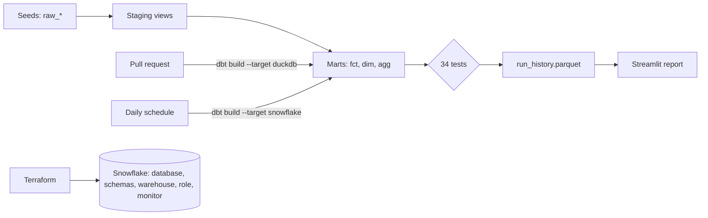

# Portable data platform

One dbt project that runs unchanged on **DuckDB** (free, on every pull request) and **Snowflake** (daily). The warehouse becomes a setting, not a rewrite.

Data is synthetic (200 customers, 1,500 orders, about 3,700 order lines), generated by `scripts/make_seeds.py`.

## What makes it portable

| Concern | How it is handled |
| --- | --- |
| Date and diff functions | dbt's cross-database macros: `dbt.date_trunc`, `dbt.datediff` |
| Functions that differ | `adapter.dispatch` in `macros/portable.sql`: `safe_divide` uses `div0null` on Snowflake and `nullif` on DuckDB |
| Connection | `profiles.yml` has two targets; secrets come from environment variables |
| Schemas | A `generate_schema_name` macro gives the same `raw`, `staging`, `marts` layout on both |
| Snowflake setup | `terraform/main.tf`: database, schemas, XS warehouse with 60 s auto-suspend, role, key-pair CI user, resource monitor (5 credits a month) |

## Status

- DuckDB: **verified**. `dbt build` passes 34 of 34 (4 seeds, 8 models, 22 tests).
- Snowflake and Terraform: written and reviewed, **not yet run** against a live account. The daily workflow stays off until you set the repository variable `SNOWFLAKE_ENABLED=true`. This README will show the first green Snowflake run once it exists.

See [HOW_TO_RUN.md](HOW_TO_RUN.md). Part of a series of six portfolio projects: https://agshivam.github.io
